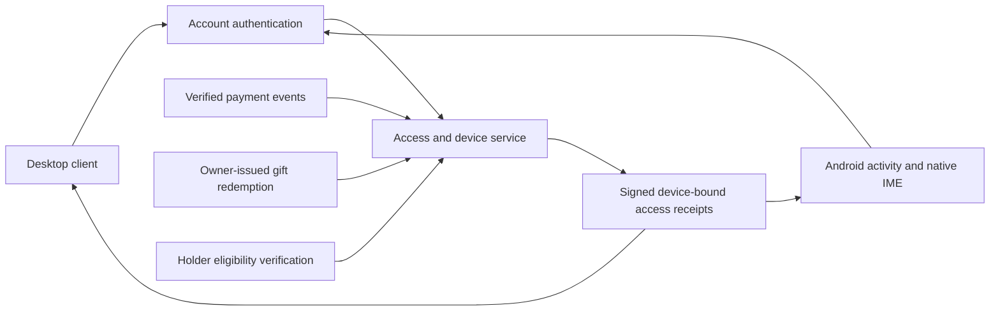

# Lectus: access and Android engineering design

Status: draft, 2026-11-13. Not approved for product implementation.
Coordinator: Orca Run `run_db09bc5a3181`. This temporary engineering spec will be
reconciled with the portable handoff/code after approval and execution. Strategy
and implementation plans retain the repository's vault convention.

## Purpose and settled requirements

Offer local dictation through a normal subscription, community eligibility or a
gift, with one understandable account/device experience across desktop and Android.

| Area | Settled requirement |
|---|---|
| Access | Target about EUR 5/month for local AI; community/holder access remains an alternative. Final consumer price is unset. |
| Identity and gifts | Passwordless email for paid/gift users; no wallet required for them. Gift codes grant 1/3/12 months to friends/others. Selling gift cards was not decided. |
| Devices and offline | Up to two personal devices, including desktop plus phone; paid/gift access works offline throughout the activated period. Replacement and strict enforcement remain unresolved. |
| Mobile | Android first, no iOS implementation. Current desktop Tauri source is not an accepted Android build. |
| Privacy and inference | Local inference is included. Existing BYO provider options remain with the user's provider billing and explicit processing permission. Account/billing services receive no audio, transcripts, history or provider API keys. |

The existing seven-day trial remains the proposed default. Equal features across
valid access routes, single-use gifts starting on redemption, no card and no
automatic charge on gift expiry are proposals to approve in the final design.
Publisher identity, tax jurisdiction, legal terms and provider/store approval are
unresolved; no company registration or regulatory exemption is inferred.

## Proposed system boundaries

Authentication authorizes online account operations. A receipt authorizes local
use; an expired login session must not invalidate an otherwise valid receipt.
Each access source retains its own interval and state, so failure/refund/expiry of
one source cannot remove another valid entitlement. The client cannot grant access
merely because a checkout returned or a login succeeded.

The backend owns authoritative account/device records, redemption transactions,
payment-event reconciliation and receipt issuance. Client adapters own protected
device keys, local receipt verification, model files and native input/output.
Audio and BYO inference traffic travel only through their separately consented
local/provider paths, never through the account backend.

Provider selection, endpoint/DTO schema, signing format and datastore are not
frozen. The auth and mechanism labs test candidate boundaries; they are disposable
evidence and must not be imported wholesale as production code.

## Client behavior and recovery

- Preserve the existing trial start during migration, linking and logout. Trial
  without an account is a proposed low-friction default, not a per-person antiabuse guarantee.
- Bind browser login to its initiating instance. Reject replay, wrong state/client
  and expired exchanges. Opening email on another device must not activate it by accident.
- Redeem gifts online, atomically and idempotently. Show dates and overlap before
  confirmation. A gift does not silently cancel an existing subscription or extend another grant.
- Recovery through the same verified email restores account access, not local
  transcripts, downloaded models or provider keys. Loss of the email needs an explicit recovery policy.
- Distinguish no entitlement, pending payment, expired session, retired device,
  uncertain local time and unavailable service. Failure to contact a service must
  preserve a valid local receipt; it must not invent a renewal beyond its interval.

## Offline and device decision

Recommended candidate: two currently registered devices, with receipts lasting
through the acquired paid/gift interval. Retiring a device blocks future issuance
and online sessions, but an offline copy may remain usable until its receipt expires.
Replacing a lost device can therefore temporarily exceed two physical devices in use.

The strict alternative reserves a slot until every issued receipt expires; a lost
device could block replacement for up to 12 months. Short leases would reduce this
window but change the settled offline requirement. None of these tradeoffs has
been accepted on the owner's behalf. Replacement quotas/support exceptions are unset.

A signed expiry proves what was granted, not the current time on a user-controlled
offline machine. Clock rollback, snapshots and modified binaries are explicit
threat-model limits. Any offline blocking rule for uncertain time needs to be
visible in the final product decision; no absolute DRM claim is made.

Current holder behavior needs deliberate migration: a cached positive balance has
no age-based expiry (`src-tauri/src/license/mod.rs:167`), and failed refreshes keep
it (`license/commands.rs:206`). The discovered seven-day holder proposal is a
behavior change, separate from the paid/gift offline period.

## Android proposal and feasibility gates

Use a native input-method service for microphone lifecycle and insertion, with a
separately reusable Rust inference/access core. A settings Activity may be native
or Tauri; this choice does not remove the native IME requirement. A voice-focused
IME with switching back to the normal keyboard is the initial UX proposal, not a
promise of adding a button inside Gboard or building a full typing keyboard.

The disposable interaction prototype must expose cancellation, stale editor
results, model readiness and offline access states. It supplies UX evidence only.
Real acceptance still requires an ARM64 build, native library/page-size validation,
visible-IME microphone capture with the Activity closed, correct insertion,
cancellation, permission recovery and performance/quality on physical devices.

ASR-only is a useful technical prototype scope, not an approved public feature cut.
Local cleanup/translation parity remains unproved. The current catalog totals about
3408 MB for Base, cleanup and translation downloads; that is not measured RAM.
Native toolchain setup, model choices and supported devices must follow evidence,
without changing the desktop toolchain or installed app.

## Material decision frontier

| Decision | Current state |
|---|---|
| Android purchase channel | Asked: Play with in-app subscription (coordinator recommendation for non-crypto UX), Play consumption-only plus web subscription, or APK first. No answer recorded. |
| Offline/device replacement | Recommended candidate preserves full offline periods and accepts residual use after replacement; explicit owner choice pending. |
| Holder identity and migration | Email requirement, wallet/account association and freshness policy remain open; preserve existing behavior until approved. |
| Recovery and time | Lost-email proof, uncertain-clock handling and replacement policy remain open. Routine protocol details belong to the coordinator. |
| Public mobile scope | Voice-IME interaction and local cleanup/translation acceptance must be settled from prototype evidence before a publication commitment. |

Published Play policy permits consumption-only access; purchasing digital access
inside the app generally requires Play Billing or an applicable enrolled program.
This does not pre-approve holder/custom-code behavior. Free publisher-issued access
must be distinguished from sold stored-value gift cards; provider eligibility for
the complete Lectus model remains unproved.

## Evidence required before implementation/release claims

The active labs cover native login transactions, signed receipt validation,
redemption/event races, Android interaction and remaining tooling inventory.
Meaningful negative controls are required. Local signatures, SQLite fixtures,
browser mocks and documentation cannot establish OS key protection, real email
delivery, provider purchase verification or native Android acceptance.

The complete design needs independent review and owner approval before contracts
are frozen and product implementation is dispatched. External service activation,
real charges/messages, hardware tests, legal publication flags, installed-app
replacement and release remain separately bounded by the architect prompt.

References: `../handoffs/2026-11-13-access-android-coordination.md` contains the
portable discovery evidence and primary-source links; `../HANDOFF.md` owns current
Run state. This draft is not yet an approval packet.
